<h3><code>parth@github ~ $ ./contributions.sh</code></h3>

  

<h3><code>parth@github ~ $ whoami</code></h3>
<table>
<tr>
<td valign="top"></td>
<td valign="top"></td>
</tr>
</table>

# Hi, I'm Parth Singh

CS (ML & Data Science) at the University of Indianapolis. I build local-first AI systems, agent infrastructure, and deterministic verification tools.

Currently: LLM evaluation and benchmark design, Handshake AI (Mar 2026 to present).

## Competitive Hackathons & Systems Honors

- [**homebrain-baton**](https://github.com/Ps23102004/homebrain-baton) *(Meta Global AI Developer Hackathon)*: Mac controller bridging Meta Muse (Ray-Ban glasses & mobile) to local apps with 0 cloud uploads. Features **Baton**, a multi-vendor agent continuity layer achieving **97% task completion** vs 68% naive retry. Includes 180s demo video.
- [**focus-auditor**](https://github.com/Ps23102004/focus-auditor) *(Amazon Developer Hackathon: Build, Ship, Shape)*: Autonomous Fire TV accessibility crawler driving live D-pad over `adb`; freezes live tests, auto-patches code via Amazon Devices Builder Tools (ADBT) over MCP (**1,104 offline tests passing, 36/36 mutation tests caught**).
- [**a-thousand-players**](https://github.com/Ps23102004/a-thousand-players) *(Nebius × NVIDIA Global AI Hackathon)*: Synthetic player swarm orchestrated by NVIDIA Nemotron on Nebius Token Factory exploring game state spaces and outputting deterministic replay bug seeds.
- [**graphhacks-quarantine**](https://github.com/Ps23102004/graphhacks-quarantine) *(Graph Hacks 2026 / FalkorDB Track 02)*: Real-time agent memory defense for FalkorDB knowledge graphs, isolating poisoned memory nodes with cryptographic audit receipts.
- [**spreadbounty**](https://github.com/Ps23102004/spreadbounty) & [**paylink-monad**](https://github.com/Ps23102004/paylink-monad) *(Monad Metropolis Hackathon)*: Verifiable maker-depth incentives on Monad, plus an autonomous x402 AI-agent invoice payment rail settling gasless USDC in <1s via EIP-3009.

## Core Projects

- [**same**](https://github.com/Ps23102004/same): find every photo that contains a specific physical object on-device. 35-region DINOv2 pyramid + SIFT RANSAC 4-DoF similarity transform (**0 / 128 same-class false accepts**).
- [**bla**](https://github.com/Ps23102004/bla): adversarial AI defense shield protecting binaries, Electron apps, and WASM against AI reverse-engineering agents (REA).
- [**llm-ladder**](https://github.com/Ps23102004/llm-ladder): cascading router across local and cloud LLMs with self-consistency voting, saving 68% token cost while retaining 98.5% frontier accuracy.
- [**Cutroom**](https://github.com/Ps23102004/Cutroom): desktop video editor in Rust (Tauri) with local media engine, frame-accurate EDL trimming, and zero cloud uploads.
- [**bully-remake**](https://github.com/Ps23102004/bully-remake): 1:1 fan port of Bully: Scholarship Edition to Unreal Engine 5 on Mac with real-time local voice NPC conversations.
- [**VisaRadar**](https://github.com/Ps23102004/VisaRadar): evidence-backed visa sponsorship validation cross-referencing job posts against real Department of Labor filings.

## Stack

Python · PyTorch · Rust · TypeScript · C++ · macOS Hypervisor / adb · Docker · FalkorDB · Three.js / WebGPU · Monad / EVM

---

Indianapolis, IN · AWS Certified Cloud Practitioner · open to Summer 2027 internships and new-grad roles · [LinkedIn](https://www.linkedin.com/in/parth-ror) · parthsingh23@icloud.com